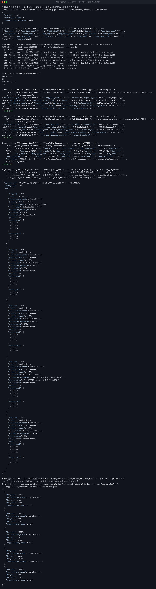
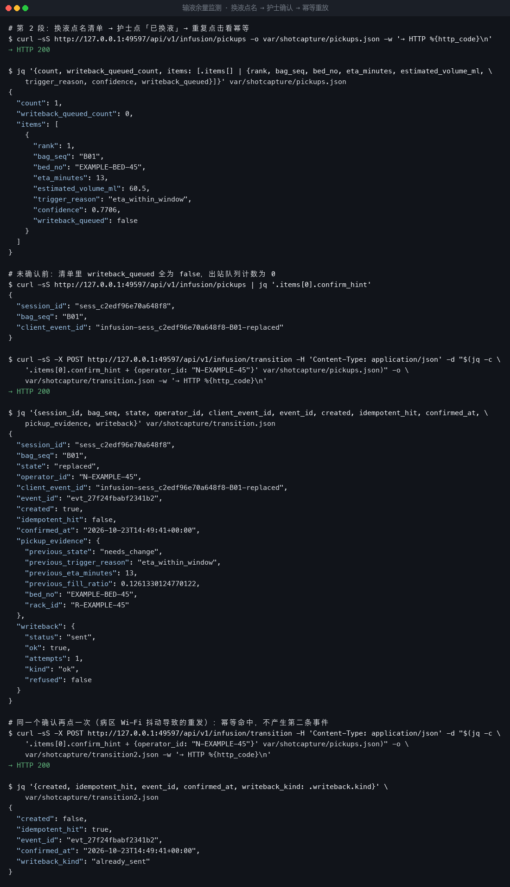
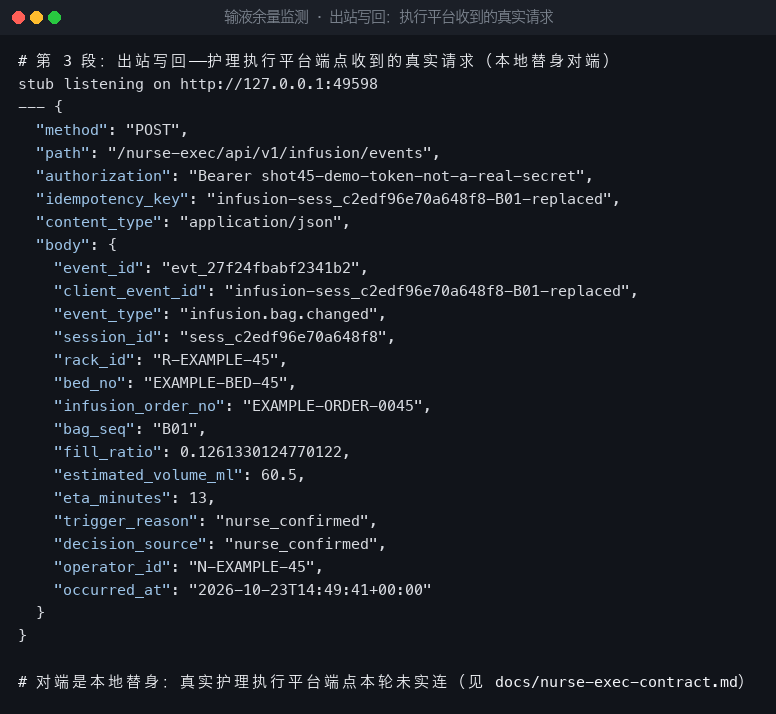
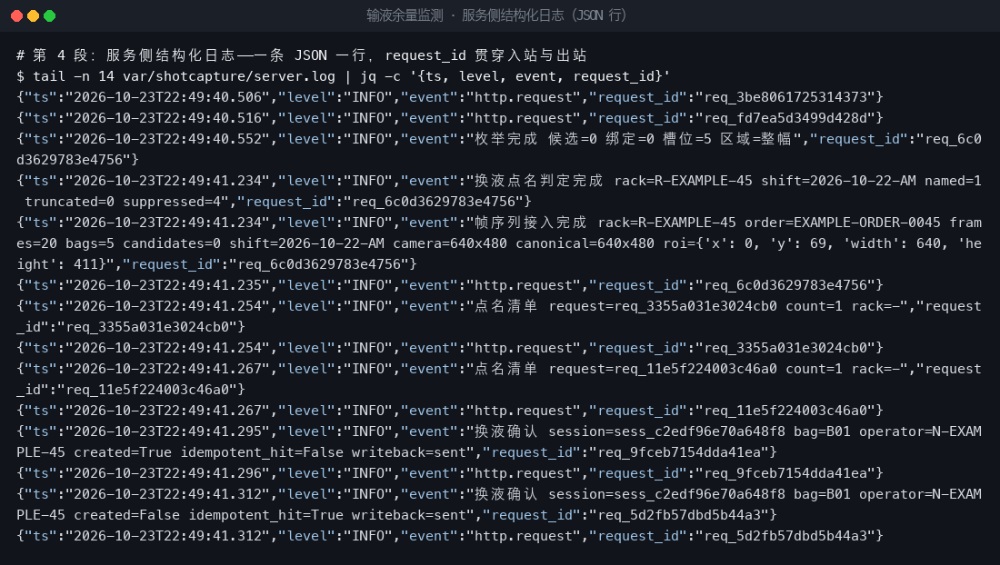
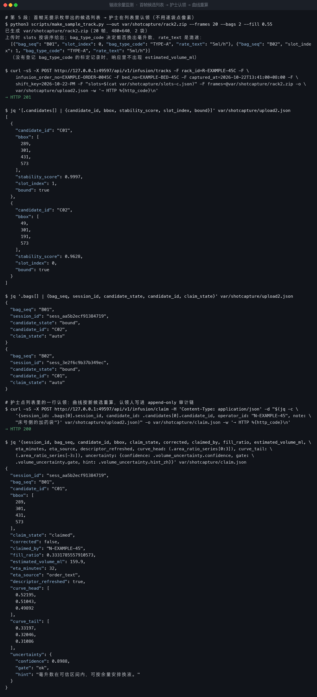

# 输液余量监测系统

> 护士对着输液架拍一段 10–20 秒短片上传，得到每袋的余量曲线、还能撑多久的估时，以及"该换液了"的点名；确认换液后自动把换液事件写回护理执行平台。

床旁输液巡视目前靠目测估量和口述交班：看一眼大概还有多少，心里估个"还能撑一会儿"，交班时再说一遍——
没有可复核的记录，也答不出"这条医嘱现在跑到哪一步了"。本服务给一条可核对的替代路径：短片进去，
余量曲线出来，点名带原因，确认后写回执行平台。
**形态**：常驻无界面 HTTP API 服务（`uvicorn infusion_monitor.api:app`，契约页 `/docs` 为 OpenAPI 3.1）。

## 适用场景 / 目标岗位

| 岗位 | 什么时候用 | 得到什么 |
|------|------------|----------|
| 病区护士 / 助理护士 | 每 1–2 小时一轮输液巡视，站在输液架前拍 10–20 秒短片 | 每袋的余量变化曲线、预计还能输多久、该换液的袋号与原因 |
| 护士长 | 床旁巡视核对本轮点名；交班前过一遍在输的输液架 | 按「谁快输完谁排头」的待换液清单，每条带触发原因、置信度与依据 |
| 信息科 | 病区服务器日常运维与接口联调 | 运行摘要、待写回队列与人工重放、错误码表、审计包导出 |
| 信息科 | 申请磁盘、规划保留期、决定要不要换数据库 | 容量测算报告、保留期清理定时任务与清理台账 |

> 本表只写岗位口语与业务时刻。REST 路径、字段名、协议与状态枚举见「命令 / API / 配置说明」。

## 能力要点

- **余量从"看一眼"变成一条可复核的曲线**：一次上传返回每袋跨帧一致的面积比序列，护士对照着看变化，不用每袋重新估，也不用靠记忆复述。
- **毫升数只在可信时出现**：没有袋型标定记录、或这一段算出来的余量落在一段宽区间里时，响应里**不出现**毫升字段，只给曲线并写明成因——不给不可信的数字驱动换液提醒。
- **毫升按袋子的真实形状算，不是面积比乘容量**：袋型登记外形参数后，系统把投影面积反解回袋内真实高度再按腔体积分；实测同一液位，朴素线性做法在四个常用袋型之间误差差出 40 ml 以上，腔体换算压到 2 ml 以内。「输完了还剩 7 毫升」这类虚报由护士的确认反推残留扣掉，证据不足就不改。
- **「还能撑多久」有出处，对不上就不给时点**：滴速先取输注医嘱、退到泵速遥测；两个都没有、或医嘱与泵速偏差超 20%，都**不给时点**并压住这袋的换液点名——把两个值连同偏差交出来请人确认，不取中间值。
- **宁可少点一次，也不让护士白跑一趟**：点名过三道闸（滞回带、每袋 15 分钟最小间隔、一轮最多 3 袋按 ETA 截断）。没被点到的袋也带原因码说清为什么，护士长能回答「这袋怎么没提醒」。单帧毛刺不误报。
- **遮挡不丢袋、换袋不接错**：被手和管路挡住的那一段标记为遮挡而不是丢弃，恢复后接回同一袋；挡太久（超丢失窗口）标「找不到了」，等重新入画时用位置 / 挂点 / 颜色三条证据同时过关才接回，认不准就明说「需要护士认领」。下一轮「还是不是这一袋」按颜色、液位、标签区、挂点几何四条证据判定，其中液柱比上一轮还高**一票否决**，判不准时响应里连 `previous_session_id` 都不出现。
- **护士确认才算数**：换液状态只能由护士在终端确认推进，服务只负责建议、出曲线、写事件；点名清单**只读**，查多少次都不产生任何写回；同一次确认点两次只算一次，事件表不新增行、对端不收第二条。**确认之后才写回，且写不丢**：换液事件带幂等键 POST 给护理执行平台；对端 5xx 或超时按失败类别指数退避（≤2 次），耗尽后挂在"待写回"清单里等人重放——欠了多久、试了几次、最后一次错在哪都落盘，绝不悄悄丢掉一条换液记录。
- **拍不好或断网都有兜底**：上传前预检先给 0–1 质量分（清晰度、亮度、反光、分辨率、歪斜），命中哪类就配一句当场能照做的动作，**只降级不拒收**——拍坏的短片照样返回曲线与毫升数，只是这些数字标上要打问号；拍到一半断了可先开一次上传、按帧号分片补传，服务逐帧报「已收到哪些、还缺哪些」，最后提交走的还是同一条计算路径（分片与一次性上传给出的曲线逐点相同），整段重传把上一版读数留档，护士长回头查得到「十分钟前报的是多少毫升」。

## 快速开始

### 依赖

Python ≥ 3.10（`requirements.txt`：FastAPI / uvicorn / pydantic / opencv-python-headless / httpx / paho-mqtt 等）。无需 GPU，默认走确定性几何核路径，生产权重路径为可选实现（换实现只改 `MODEL_IMPL` / `MODEL_ID`）。本产品**明确不做图形界面**，对外契约以 OpenAPI 3.1 + curl 验收。

### 安装

```bash
cd infusion-volume-monitor
python3 -m venv .venv && source .venv/bin/activate && pip install -r requirements.txt
```

### 配置

复制 `.env.example` 为 `.env`，按院内实际填写 7 组凭据位；启动时按名校验，缺项会明确报出缺哪一个。**全部凭据位只从环境变量读，代码与配置文件中不出现明文。** 其余调参项（分割档位、模型护栏、平滑与质检门限、保留期）见下方「关键配置项」与 [`docs/cli.md`](docs/cli.md)；病区机器上的落地方式见 [`INSTALL.md`](INSTALL.md)。

| 配置项 | 默认值 | 说明 |
|--------|--------|------|
| `NURSE_EXEC_BASE_URL` / `NURSE_EXEC_API_TOKEN` | 无（必填） | 出站写回目标与 `Authorization: Bearer` 凭据 |
| `MQTT_HOST` / `_PORT` / `_USERNAME` / `_PASSWORD` | 无（必填） | 输液泵遥测订阅 broker；无 broker 的病区可用 webhook 兜底 |
| `LLM_BASE_URL` / `LLM_API_KEY` / `LLM_MODEL` / `LLM_TIMEOUT` | 无（必填）/ `8.0` | OpenAI-compatible 模型网关（`chat/completions`） |
| `DATABASE_URL` / `FRAMES_ROOT` | `sqlite:///./var/infusion_monitor.db` / `./var/frames` | 存储与会话帧目录（认领纠错要按帧重算，删了无法纠错）；换 PostgreSQL 只改前者 |

### 构建与验证

```bash
python3 -m pytest tests/test_smoothing.py tests/test_failure_modes.py -q  # 收窄：只跑改动模块
python3 -m pytest -q                             # 全量 1293 用例：1283 passed / 10 skipped（缺权重如实 skip）
python3 -m pytest tests/contract/ tests/e2e/test_writeback_e2e.py -q    # 契约 + 端到端（本地替身端口）
PYTHONPATH=src:. python3 var/verify_task40.py    # 独立复核：真 uvicorn + 真 curl，退避真睡 5s
python3 scripts/capture_demo_shots.py            # 一次 curl 全链路：起服务→上传→点名→确认→写回，落真实截图
```

### 主命令速查

```bash
uvicorn infusion_monitor.api:app --host 0.0.0.0 --port 8000     # 启动常驻服务（契约页 /docs）
curl -X POST http://127.0.0.1:8000/api/v1/infusion/tracks -F rack_id=R-07A -F infusion_order_no=<EXAMPLE_ORDER> \
     -F bed_no=07-12 -F captured_at=2026-01-01T09:00:00 -F slots='[{"bag_seq":"A03","slot_index":3,"bag_type_code":"NS1000"}]' -F frames=@rack_01.zip
curl -sS http://127.0.0.1:8000/api/v1/infusion/pickups            # 点名清单（只读，不产生写回）
curl -sS http://127.0.0.1:8000/api/v1/summary                    # 值班现状：待换液 / 欠账 / 降级次数
curl -X POST http://127.0.0.1:8000/api/v1/infusion/transition \  # 护士确认换液（confirm_hint 原样回填）
     -H 'Content-Type: application/json' -d '{"session_id":"<SESSION_ID>","bag_seq":"A03","operator_id":"N-EXAMPLE-7","client_event_id":"infusion-<SESSION_ID>-A03-replaced"}'
python3 scripts/check_config.py       # 启动前自检 7 组凭据位（退出码 0 = 齐全，1 = 逐组点名缺哪个）
```

## 命令 / API / 配置说明

### 关键配置项

| 配置项 | 默认值 | 说明 |
|--------|--------|------|
| `LLM_FUSION_ENABLED` / `LLM_FUSION_CONFIDENCE_FLOOR` | `false` / `0.60` | 是否请模型复述结论做一致性仲裁；**关掉不影响任何结论**，模型缺席时 `decision_source` 恒为 `threshold_only` |
| `LLM_MAX_TOKENS_PER_REQUEST` / `LLM_DAILY_CALL_LIMIT` | `1200` / `2000` | 单请求 token 上限与每日调用上限（按院内工作日 UTC+8 切）；越过即退阈值路径，**一次 HTTP 都不发、不静默截断** |
| `WEBHOOK_SIGNING_SECRET` / `_TOLERANCE_SECONDS` | 未设（通道关闭） / `300.0` | webhook 兜底通道的 HMAC 密钥与重放窗口。**未设就没有这个端点**（404），不用默认密钥开着 |
| `WRITEBACK_TIMEOUT` / `WRITEBACK_RETRY_ENABLED` | `5.0` / `true` | 出站单次超时与待写回队列的后台重试 |
| `UPLOAD_MAX_BYTES` / `UPLOAD_MAX_SECONDS` / `FRAME_SHORT_EDGE_FLOOR` | 160MB / `120.0` / `320` | 整段上传上限与短边硬下限；超限指路分片续传，**已收到的部分不作废** |

全表见 [`docs/cli.md`](docs/cli.md)。

### CLI 子命令 / 接口端点

| 命令或路径 | 用途 | 关键参数 |
|------------|------|----------|
| `POST /api/v1/infusion/tracks` | **主路径**：上传帧序列，返回每袋余量曲线、毫升/ETA 与本轮点名 | `rack_id`/`infusion_order_no`/`bed_no`/`captured_at`/`slots`/`frames`(zip)/`client_event_id` |
| `GET /api/v1/infusion/pickups` | 点名清单（只读）：ETA 升序 → 床号 → 袋序，每条带依据与 `confirm_hint` | `rack_id`（可选）/`limit`（≤100） |
| `POST /api/v1/infusion/transition` | 护士确认换液，推进 `replaced` 并幂等写回 | `session_id`/`bag_seq`/`operator_id`/`client_event_id`/`rack_id`（可选） |
| `POST /api/v1/infusion/claim` · `/decision` | 在首帧候选列表里认领一袋（按新候选**重算整条曲线**）／重算某袋的换液判定 | `candidate_id`/`operator_id`；`session_id` |
| `POST /api/v1/infusion/calibrations` | 登记袋型标定（首次建版 / 改版 / 预约生效）；带 `cavity{}` 时毫升改走腔体几何换算 | `bag_type_code`/`capacity_ml`/`dead_volume_ml`/`samples[]`/`cavity{}`/`effective_from` |
| `GET /api/v1/infusion/pending` · `POST …/{event_id}/replay` | 待写回清单（欠了多久、试了几次、最后错在哪）与人工重放（幂等） | `rack_id`/`bed_no`/`status`；`operator_id`（必填） |
| `POST /uploads` · `…/chunks` · `…/commit` · `…/cleanup` | 断网续传：开启 → 分片补传 → 查断点 → 提交（提交走**与 `/tracks` 相同**的主路径） | `expected_frames`/`chunk`/`frame_offset`/`dry_run` |
| `POST /api/v1/infusion/telemetry/webhook/{rack_id}` | 入站泵速遥测的 **webhook 兜底通道**（给没有 broker 的病区），与 MQTT 共用同一份解析与去重 | `bag_seq`/`pump_rate_ml_per_h` 必填；头 `X-Infusion-Signature` 必填 |
| `GET /api/v1/health` · `/summary` · `/error-codes` · `GET /docs` | 健康检查／运行摘要（值班入口）／机器可读错误码表／OpenAPI 3.1 契约页（各接口 responses 已逐条写明会返回的错误码） | 无 |

全表（约 30 个端点）见 [`docs/cli.md`](docs/cli.md) 与 `/docs`。

### 错误与降级

422 的 detail 恒为三段式 `error_code / message / issues[{code, field, reason, suggestion}]`——不是框架默认的 `[{loc, msg}]`；完整码表（约 90 条）见 [`docs/cli.md`](docs/cli.md) 与 [`docs/error-codes.md`](docs/error-codes.md)（由代码生成）。

| 场景 | 表现 | 处理方式 |
|------|------|----------|
| 整段上传超 160MB 或超 120 秒 | `413 UPLOAD_BUDGET_EXCEEDED` / `408 UPLOAD_TIMEOUT` | 改走分片续传；**已收到的部分不作废**（病区断网是常态，不是异常） |
| 状态迁移非法（`monitoring` 直跳 `replaced`、`replaced` 回退） | `409` + 审计行（`outcome="rejected"`） | 走合法路径：先产出点名，再由护士确认 |
| 袋型无标定 / 低置信 / 高遮挡 / 几何版本缺失 | 响应中**不出现** `estimated_volume_ml` 与 `eta_minutes`（不是 null），带成因码与区间 | 前者补标定登记、后三者重拍即可——门禁与未标定分开报，处理方式不同 |
| 滴速给不出来 / 医嘱与泵速偏差 > 20% | 毫升数照给，`eta_minutes` 不出现，`eta_source="unavailable"`/`"conflict"` | **不取中间值**：确认是医嘱没改还是泵没调，改完重传一轮 |
| 认不出「还是不是上一轮那袋」/ 挂点对不上 | `reanchor_state="unbound"` 或 `slot_state="mismatched"` + 原因码，`claim_required=true` | **不猜**：在候选列表里点一行认领，系统按新候选重算曲线 |
| 出站 5xx / 超时 / 半开连接 | 按类别退避（默认 1s、4s）≤2 次后置 `pending_writeback`，事件行保留 | 进待写回清单可人工重放；**绝不静默丢事件**，失败摘要过脱敏不含凭据 |
| 模型不可达 / 超时 / 5xx / 输出不可解析 / 越权 | 退确定性阈值路径，`decision_source="threshold_fallback"`，四类失败各有 `fallback_reason` | **不写回、不推进 `needs_change → replaced`**，标 `pending_manual_review`；模型输出 `replaced` 被契约拒收 |
| 拍得不好（出框 / 糊 / 反光 / 歪 / 暗光） | `capture_degraded=true` + 中文补拍建议；**仍返回 `201`** | 按建议重拍这一段；拍坏与查不出数是两回事，拒绝权只留给硬校验 |

### 对接现有系统

- **出站（写）**：`POST {NURSE_EXEC_BASE_URL}/api/v1/infusion/events`，`Authorization: Bearer $NURSE_EXEC_API_TOKEN`，幂等键同时出现在请求头 `Idempotency-Key` 与请求体 `client_event_id`（两侧同值，对端任一侧去重都不漏）。出站只发生在护士确认触发 `replaced` 之后；14 个字段与 11 类失败的分类表落盘在 [`docs/nurse-exec-contract.md`](docs/nurse-exec-contract.md)（由代码字段表生成）。
- **入站**：上传走 `POST /api/v1/infusion/tracks`，multipart/form-data，帧为 zip（成员 `frame_%05d.jpg`，12–1200 帧）；泵速遥测走 MQTT `hospital/infusion/+/telemetry`（字段 `bag_seq`/`pump_rate_ml_per_h`/`device_sn`/`ts`），无 broker 的病区改走 HTTP 回调，**两条通道共用同一份解析、同一套去重、同一个缓存**（[`docs/webhook-contract.md`](docs/webhook-contract.md)）。
- **模型判定（出站，仅提示）**：`POST {LLM_BASE_URL}/chat/completions`，带 `response_format={"type":"json_object"}`；业务层只经**单一模型网关**调用（换院内自建端点或本地部署权重只改环境变量，不动业务代码），输出契约见 [`docs/llm-contract.md`](docs/llm-contract.md)。模型结论只是一条提示，**不推进任何业务状态**。全部凭据位读环境变量；自动化测试只连本地测试替身，真实端点需院内联调环境接通（模型缺席时退确定性阈值路径，见「错误与降级」）。

## 典型场景

### 场景 1：病区护士巡视时上传短片

走到 07 床，对准输液架拍 10–20 秒（12 帧以上）→ 上传 → 拿到 A01–A03 三袋的余量曲线与毫升估计 → 按 `trigger_reason` 处理被点名的袋；拍糊了会给出补拍建议，但这一轮照样出数。
```bash
curl -X POST …/tracks -F rack_id=R-07A -F bed_no=07-12 -F infusion_order_no=<EXAMPLE_ORDER> -F captured_at=2026-01-01T09:00:00 -F slots='[…]' -F frames=@rack_01.zip
```

### 场景 2：护士确认换液并写回执行平台

护士站先拉点名清单，按 ETA 升序看到最先要换的那一袋 → 护士在终端确认已换，把清单里那条的 `confirm_hint` 原样回填 → 推进到 `replaced` 并幂等写回一条换液事件；下一轮巡视上传时，同一 `bag_seq` 续上这条曲线。
```bash
curl -sS http://127.0.0.1:8000/api/v1/infusion/pickups   # 只读，不会触发任何写回
curl -X POST …/transition -H 'Content-Type: application/json' -d '{"session_id":"…","bag_seq":"A03","operator_id":"N-EXAMPLE-7","client_event_id":"infusion-…-A03-replaced"}'
# 首次 → created=true / idempotent_hit=false；重放同一 client_event_id → idempotent_hit=true，event_id 与首次完全一致
```

### 场景 3：信息科排查待写回队列

交班时发现执行平台没收到换液事件 → 查运行摘要的待写回计数 → `GET …/pending` 拿到事件与最后错误 → 平台恢复后重放（幂等，不产生第二条业务事件，欠账在送达前一直留在清单里）。
```bash
curl -sS http://127.0.0.1:8000/api/v1/summary                    # 待换液袋数 / 待写回积压 / 模型降级次数
curl -sS http://127.0.0.1:8000/api/v1/infusion/pending          # 哪几袋欠着、欠了多久、最后一次错在哪
curl -X POST http://127.0.0.1:8000/api/v1/infusion/pending/<EVENT_ID>/replay -H 'Content-Type: application/json' -d '{"operator_id":"INFO-07"}'   # 重放（幂等，不产生第二条）
```

### 场景 4：护士拍到一半，走廊尽头断网了

终端先开一次上传拿到 `upload_id`，按帧号分片补传（断在哪从哪续，不重拍）→ 每传一片查一次断点，服务逐帧报「已收到哪些、还缺哪些」→ 收齐后提交，得到的曲线与一次性上传**逐点相同**；信息科定时跑清理命令回收当天没人补完的半成品（只删暂存目录，已完成会话的帧一帧不少）。四步命令（`POST /uploads` → `…/chunks` → `GET …/{id}` → `…/commit`）见 [`docs/cli.md`](docs/cli.md)；真实演练见 [`docs/acceptance.md`](docs/acceptance.md) 的「断点续传与重放」一行。

## 输出样例

以下均为**真实跑出来的响应**（真 uvicorn + 真 curl + 真 SQLite / 真替身对端），标识符一律脱敏；完整样例见 [`docs/examples.md`](docs/examples.md)。

### 上传响应：曲线、毫升、ETA（面积比是观测值，毫升是标定后的换算值）

```json
{"session_id":"S-20260101-0001","rack_id":"R-07A","bed_no":"07-12","frames":36,
 "bags":[{"bag_seq":"A03","slot_index":3,"calibration_state":"calibrated",
   "area_ratio_series":[0.71,0.70,0.69,0.68,0.68,0.67,0.66,0.65,0.64,0.64,0.63,0.62],
   "fill_ratio":0.62,"estimated_volume_ml":118.4,"calibration_version":2,"eta_minutes":26,
   "eta_source":"order_text","rate_ml_per_h":275,"status":"monitoring","quality_flags":[]}]}
```

### 点名清单：一行一条，写清凭什么点它

```json
{"count":2,"writeback_queued_count":0,"items":[
  {"bag_seq":"B04","bed_no":"07-12","state":"needs_change","trigger_reason":"eta_within_window",
   "eta_minutes":15,"estimated_volume_ml":72.4,"confidence":0.6089,"writeback_queued":false,
   "confirm_hint":{"session_id":"sess_<EXAMPLE>","bag_seq":"B04"},"rank":1},
  {"bag_seq":"C01","state":"needs_change","trigger_reason":"near_empty_observed","fill_ratio":0.0091,"calibration_state":"uncalibrated","confidence":0.8325,"writeback_queued":false,"rank":2}]}
```

`writeback_queued` 恒为 `false`：清单只读，查一次不可能把一条未确认的换液推给对端。未标定袋型照样点名（"袋子几乎没液体了"是直接观测，不需要标定），但文案逐字写明**依据面积比**。

### 出站写回事件（护理执行平台收到的载荷；14 个字段的规范见 [`docs/nurse-exec-contract.md`](docs/nurse-exec-contract.md)）

```json
{"event_id":"<EXAMPLE>","client_event_id":"evt-<EXAMPLE>","event_type":"infusion.bag.changed","rack_id":"R-07A",
 "bed_no":"07-12","infusion_order_no":"<EXAMPLE_ORDER>","bag_seq":"A03","fill_ratio":0.39,
 "estimated_volume_ml":118.0,"eta_minutes":26,"trigger_reason":"eta_within_window",
 "decision_source":"threshold_fallback","operator_id":"N0123","occurred_at":"2026-01-01T09:12:03"}
```

> 门禁的形态是**字段整体不出现**而不是 null：未标定袋型那一袋的 `estimated_volume_ml` 与 `eta_minutes` 两个键都不存在，只给 `area_ratio_series` 与 `calibration_state="uncalibrated"`；低置信时另给 `volume_uncertainty` 的区间、置信度与成因码。

### 护士确认换液：首次确认与幂等重放

```json
{"session_id":"sess_c2edf96e70a648f8","bag_seq":"B01","state":"replaced","operator_id":"N-EXAMPLE-45",
 "client_event_id":"infusion-sess_c2edf96e70a648f8-B01-replaced","event_id":"evt_27f24fbabf2341b2",
 "created":true,"idempotent_hit":false,"confirmed_at":"2026-10-23T14:49:41+00:00",
 "pickup_evidence":{"previous_state":"needs_change","previous_trigger_reason":"eta_within_window","previous_eta_minutes":13},
 "writeback":{"status":"sent","ok":true,"attempts":1,"kind":"ok","refused":false}}
```

重放同一 `client_event_id` 时 `event_id` 与 `confirmed_at` **与首次逐字相同**，只多三处标记：`created` `true→false`、`idempotent_hit` `false→true`、`writeback.kind` `ok→already_sent`；事件表不新增行，对端不收第二条。`pickup_evidence` 留的是**确认之前**的判断依据（确认会把 `trigger_reason` 覆盖成 `nurse_confirmed`），事后查得到「当初是按哪条理由点的名」。逐字段表见 [`docs/examples.md` → 12](docs/examples.md)。

### 终端回显与服务侧日志

```console
$ curl -sS http://127.0.0.1:49597/api/v1/infusion/pickups | jq '.items[0].confirm_hint'
{"session_id":"sess_c2edf96e70a648f8","bag_seq":"B01","client_event_id":"infusion-sess_c2edf96e70a648f8-B01-replaced"}
$ curl -sS -X POST http://127.0.0.1:49597/api/v1/infusion/transition -H 'Content-Type: application/json' \
    -d "$(jq -c '.items[0].confirm_hint + {operator_id: "N-EXAMPLE-45"}' pickups.json)" -w '→ HTTP %{http_code}\n'
→ HTTP 200
```

服务侧一行一条 JSON，同一个 `request_id` 把「枚举 → 点名判定 → 接入 → 确认 → 出站」串起来（截图为 [`docs/screenshots/04-service-log.png`](docs/screenshots/04-service-log.png)）：

```jsonl
{"ts":"2026-10-23T22:49:41.234","level":"INFO","event":"换液点名判定完成 rack=R-EXAMPLE-45 shift=2026-10-22-AM named=1 truncated=0 suppressed=4","request_id":"req_6c0d3629783e4756"}
{"ts":"2026-10-23T22:49:41.234","level":"INFO","event":"帧序列接入完成 rack=R-EXAMPLE-45 frames=20 bags=5 candidates=0 camera=640x480","request_id":"req_6c0d3629783e4756"}
```

> 「枚举完成 候选=0」不是故障：这支合成短片的液体饱和度恰在枚举稳定性探测高阈值之下，首帧候选被判 0 分剔除，主路径改走**槽位先验起锚**，曲线、毫升与点名仍照常给出（详见「概念 / 实测对照」末尾的诚实标注）。

运行摘要（值班入口 `GET /api/v1/summary`）的完整响应见 [`docs/examples.md`](docs/examples.md)：`pending_writeback_count` 只数退避耗尽的真积压，`unsent_pending_count` 单列——护士长不会误以为自己漏点了确认。

## 概念 / 实测对照

### 视觉目标

见 `docs/concepts/visual-target-card.md`：三个状态（服务启动日志 / 首次上传回显 / 确认写回）、画面类型（服务运行日志 + 终端 curl 会话 + OpenAPI 3.1 契约页）、配色与信息层级，以及"只画当前依赖真能画出来的东西"这一约束。本产品**明确不做图形界面**，目标画面里没有 Web 页面，也没有任何像素级掩膜叠加预览。

### 实测证据

下面五张 PNG 全部是**真实跑出来的**画面：`python3 scripts/capture_demo_shots.py` 起一个真的 uvicorn 进程（`python -m infusion_monitor.server`，结构化 JSON 日志）与一个本地替身对端，用真的 `curl` 走完「登记标定 → 上传帧序列 → 点名清单 → 护士确认换液 → 出站写回」，再把这些命令的**真实 stdout/stderr** 渲染成终端截图。截图里没有任何手绘或事后修饰的内容。











> **诚实标注**：上面是**实测**（真实命令的真实输出），`docs/concepts/visual-target-card.md` 是**视觉目标**。差距摆在明面上：目标卡设想的是"一眼看懂的摘要画面"，实测给出的是**可复制的完整 JSON 与纯文本日志**——本产品明确不做图形界面，截图里不会出现目标卡设想的颜色标注与摘要面板；截图里的对端是**本地替身**，真实护理执行平台端点本轮未实连；短片是**程序合成**的，真实院内短片须医院授权采集；本环境**无 CUDA、无生产权重**，掩膜来自确定性几何核，截图中的读数不等同于任何神经分割模型的精度（公开 VOS 子集上的对照见 [`docs/benchmark-vos.md`](docs/benchmark-vos.md)）。另有一处真实边界：第 1 段短片的液体饱和度为 119，恰在枚举稳定性探测高阈值（96+24=120）之下，首帧候选被判 0 分剔除，主路径改走槽位先验起锚、曲线与点名仍照常给出；第 5 段换一支饱和度更高的短片候选即正常出现（已记入 `discoveries.md`，非渲染问题）。

## 架构与数据流

```
  短片(zip 帧序列) ──▶ M1 入站接入：解包校验 / 帧质量预检 / 缩放 ROI
  POST /tracks              │ （硬校验不过 = 422 + 中文补拍建议；拍坏只 degraded）
                            ▼
                 M2 主路径内核：首帧候选枚举 → 身份记忆 → 逐帧传播
                                → 掩膜几何后处理 → 面积比序列（遮挡帧标 null 不插值）
                            ▼
                 M3 体积标定：分段带 / 袋型腔体几何 → 毫升 + ETA
                                滴速优先级：医嘱文本 → 泵速遥测 → 给不出就不给
                            ▼ （无标定 / 低置信 / 高遮挡 = 门禁，不出毫升字段）
     ┌──────────────────────────────────────────────────────────┐
     │ M4 身份与状态机：跨会话重锚 / 认领 / needs_change 判定    │
     │   monitoring → needs_change →（护士确认）replaced           │
     └──────────────┬──────────────────────────┬───────────────┘
                    ▼                          ▼
   M6 模型网关（OpenAI-compatible）   M5 出站写回 HTTP（只发生在护士确认之后）
   一致则采信，冲突/越界退阈值路径     POST 护理执行平台 + 幂等键
   不推进任何业务状态                  退避 ≤2 次 → pending_writeback 清单
                    ▼                          ▼
   SQLite：bag_session / infusion_event / inference_audit / bag_type_calibration
           + append-only 审计链 + 待写回队列（业务写与审计写同生共死）
   入站遥测：MQTT hospital/infusion/+/telemetry 或 POST /telemetry/webhook/{rack_id}
             ──▶ 速率交叉校验 / ETA 来源（两通道共用同一份解析、同一套去重、同一个缓存）
```

### 关键不变量

完整 30 余条见 [`docs/architecture.md`](docs/architecture.md)；每条都对应一处实现与一组测试。最要紧的几条：

- **不可信数字不出门**：无标定或低置信时响应中不出现毫升字段（整体不出现，不返回 null 占位）；滴速给不出来时**只压住时点、保留毫升**并抑制该袋点名，不拿猜出来的时点催护士换袋。**幂等键由服务端唯一持有**：出站事件以 `client_event_id` 唯一约束，键只由 (会话, 袋序) 决定、**不含确认时刻**（带时间戳的键每次重试都不同，那不叫幂等键）；点名清单把键随 `confirm_hint` 一起发下去让终端原样回填，自编一律 422 拒收。
- **未确认不出站**：出站前先查会话状态，不是护士确认过的 `replaced` 一律拒发（连 HTTP 都不发）；点名清单只读，`writeback_queued_count` 恒为 0。
- **并发与越权**：同会话的 transition 串行化（写锁内复核前提）；重复上传覆盖会话而非追加。越权写入 `403` + 一行 `rejected` 审计，且**拒绝判定发生在写事务之外**——否则回滚会连审计行一起抹掉，恰好抹掉最该留痕的那次尝试。
- **遮挡不丢弃、不猜接**：被挡的帧保留位置、面积比留 `null` 不插值；恢复时拿最近几条记忆**按相似度加权**比对，不是只比最新一帧；超过丢失窗口置 `lost` 并交出轨迹，**绝不静默新建轨迹把两袋曲线接在一起**。**缺证据不等于「看着不像」**：某项判据不存在时该项退出加权并重新归一，而不是记 0 分——0 分意味着「看着确实不像」，缺证据意味着「没看见」，两者混同会让本来该接上的袋永远接不上。
- **原始值永不篡改，异常只降级**：平滑层**只加不改**；物理上不可能的上升段标 `outlier` 并保留原值，被挡住的帧保持 `null`；受限重建是单独一条序列，补了哪些帧、为什么补都逐条留档。（另有：轨迹 ID 跨帧恒定、落空帧留 `null` 占位；判不出来的量给 `null` 而不编一个数字。）
- **模型只有一个入口、降级有据可查**：四类失败各有独立原因码，统一退确定性阈值路径；输出不合契约（缺 `trigger_reason`、枚举越界、自评置信度低于 0.60）一律不采信；**护栏只挡不改写**（不静默截断），越过上限时一次 HTTP 都不发。**失败不静默改数据**：出站失败进重试队列保持 `pending_writeback`；帧质量差只标 `degraded` 并给补拍建议，不静默改数、不粗暴拒收（拒收权只留给帧数 / 分辨率 / 帧序这些硬校验）。**清理只清像素，不清读数，更不清留档**：保留期到了清的是原始帧，面积比曲线、毫升数、ETA、换液结论全部留在会话行里；未完成的会话、有欠账的、共享目录里有别的袋子还在核对的，一个都不动；审计链是飞检留档，任何保留期都不碰它。

## 安全与合规边界

- 本服务只产出余量曲线、毫升估计、ETA 与换液**建议**，不输出诊断或治疗建议，不代签、不自动签名；换液状态推进与出站写回的**唯一触发源**是护士确认，模型与阈值引擎都不得直接推进业务状态。
- 不落患者姓名、身份证、住院号等可识别明细；输注单号由医嘱 / 护理单元系统作为权威标识给定。全部凭据位读环境变量，代码与配置文件中不出现明文；错误日志、失败摘要与审计行均不含凭据。

## 验收与自检

全表（约 110 条逐条可复跑命令与期望结果）见 [`docs/acceptance.md`](docs/acceptance.md)。代表性验收项：

| 验收项 | 命令 | 期望结果 |
|--------|------|----------|
| 上传端到端可用 | `curl -X POST …/api/v1/infusion/tracks -F frames=@rack_01.zip …` | 返回 `session_id` 与每袋 `area_ratio_series` |
| 门禁是算出来的不是拍出来的 | `python3 -m pytest tests/test_uncertainty.py -q -k derived_not_chosen` | 20% 液位（85 ml）放行、5%（29 ml）挡下，交点落在余量约 41 ml |
| 幂等确认 / 未确认不出站 | 同一 `client_event_id` 连发两次 transition；会话停在 `needs_change` 时触发写回 | 第二次 `idempotent_hit=true` 且事件表行数不变；未确认时一次 HTTP 都不发，事件保持 `pending` + `writeback.refused` 审计 |
| 出站契约不漂移 | `python3 -m pytest tests/contract/test_writeback_contract.py -q` | 替身收到 `Bearer` + `Idempotency-Key` 同值；请求体 14 个字段与出站字段表逐一对应 |
| 出站退避真睡 | `PYTHONPATH=src:. python3 var/verify_task40.py` | 真 uvicorn + 真 TCP 替身：43/43 OK，退避真睡 5.04 秒（1s + 4s） |
| 模型无权推进状态 | `python3 -m pytest tests/test_model_gateway.py -q` | 替身返回 `{"decision":"replaced"}` 被契约拒收并降级阈值路径，四种失败各自可区分 |
| 审计七类动作齐全 | `python3 -m pytest tests/test_audit_chain.py -q` | 七类动作均由**真实产品路径**落出行来；删掉任一行后链摘要改变 |
| 遮挡后接回同一袋 | `python3 -m pytest tests/test_memory_bank.py -q` | 遮挡 3 帧后恢复点判 `reappeared`，`bag_seq` 不变、空档仍留 `null` |
| 保留期清理不越界 | `PYTHONPATH=src:. python3 var/verify_task44.py` | 过期帧目录被删且读数仍在库里；未完成、有欠账、共享目录的一律留下并带原因码 |
| 全量测试通过 | `python3 -m pytest -q` | 1293 用例：1283 passed / 10 skipped（权重档缺权重如实 skip），0 failed |

## 项目结构

```
infusion-volume-monitor/
├── README.md / INSTALL.md / requirements.txt / .env.example / Dockerfile / qrcode.jpg / .gitignore
│        # 产品说明（本文件）/ 病区侧安装（目录权限、systemd 自启、换库触发条件）/ 依赖 / 凭据样例 / 镜像 / 二维码 / 排除运行期产物
├── docs/                       # 分层文档，全表与长样例都在这里（README 只留速查与摘录）
│   ├── cli.md · examples.md · acceptance.md · architecture.md
│   │        # 命令/配置全表（约 65 环境变量 / 30 端点 / 90 错误降级）/ 输出样例全集 / 验收全表（110+ 条）/ 模块方框图与不变量全表（30+ 条）
│   ├── error-codes.md · nurse-exec-contract.md · llm-contract.md · webhook-contract.md
│   ├── prompt-templates.md · storage.md · benchmark-vos.md · synthetic-data.md   # 均由代码或脚本生成，不手改
│   └── concepts/ · screenshots/     # 视觉目标卡 / 真实运行截图（README「概念 / 实测对照」引用）
├── src/infusion_monitor/
│   ├── config.py · errors.py · logging_utils.py · server.py · synth.py · vos_dataset.py   # 配置面、错误码真源、结构化日志、进程入口；后两者是数据层（运行时不 import）
│   ├── api/                                 # HTTP 接口面：上传、查询、认领、点名清单（只读）、换液确认（幂等键服务端唯一生成）、摘要、审计导出；webhooks.py 为遥测 webhook 面
│   ├── bench/                               # IoU / J / F / J&F 计算器与「记忆 vs 阈值单帧」对照基线
│   ├── ingest/                              # 解包与硬校验、上传前帧质量预检（给分 + 中文补拍建议）、缩放与 ROI、分片续传
│   ├── core/                                # 主路径内核：预测器协议与档位注册表、首帧候选枚举、逐帧传播与多袋并行、top-k 记忆库、可见度与遮挡续接、丢失轨迹再获取、帧间关联、掩膜后处理（连通域/孔洞/孤岛/粘连分离）、平滑、拍摄质量分类
│   ├── calibration/                         # 分段带与袋型腔体几何（含几何版本号）、残留补偿与自校准、医嘱速率解析、滴速优先级与 ETA、体积不确定度与置信门禁
│   ├── identity/                            # 换液点名引擎、外观描述子（三档）、四项加权重锚与认领、幂等键与越权边界
│   ├── adapters/                            # 出站写回客户端（字段表与失败分类表真源）、投递策略、待写回台账、MQTT 订阅与 webhook 兜底
│   ├── gateway/                             # 单一 OpenAI-compatible 网关、审计、融合仲裁、提示词模板注册表、用量与延迟护栏
│   └── store/                               # schema / 迁移 / 仓储、保留策略与清理、append-only 审计链与 CSV 导出、连接串抽象与事务
├── tests/ · scripts/           # 契约（出站写回 / 预测器协议 / 模型协议）、e2e 对接演练、替身与脱敏样例；配置自检、子集取数、保留期清理、容量测算、截图采集
└── var/                        # 独立复核脚本（verify_task*.py）：真进程 + 真 HTTP + 真 SQLite，逐条核对
```

## License

MIT

---

## 关注我们

欢迎扫码关注公众号，获取项目更新与交流加群：

